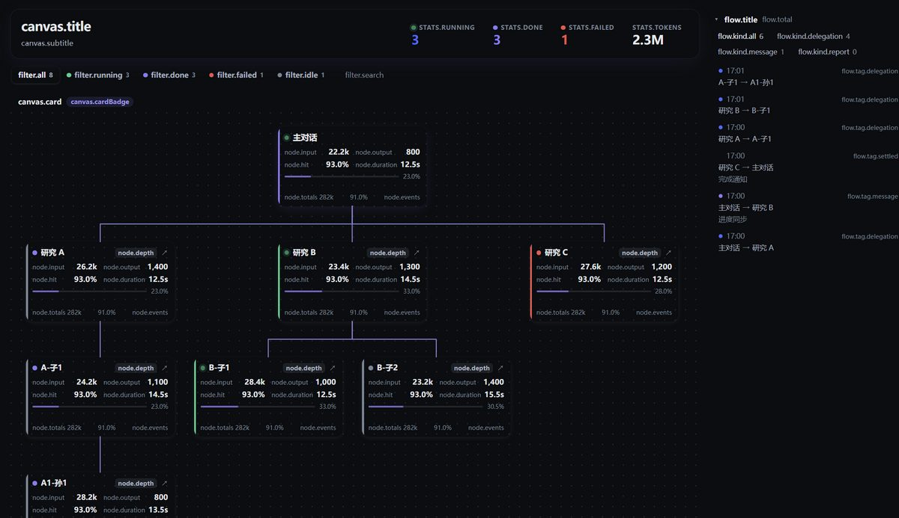

# @local/dsh-subagent-token-graph

在 DSH 对话界面新增「Token 节点图」页签：把当前会话树（主对话 + 全部派生层级的子代理）渲染成一张**自上而下的节点图**——父子用折线连接，每个节点显示会话类型、运行状态、最新轮输入/输出 token、缓存命中率、上下文占用与耗时。视觉语言参照 `dsh-context` 的多 Agent 编队页（fleet / `lc-pulse-*`），并补齐它没有的**状态过滤**。



- 插件名：`@local/dsh-subagent-token-graph`
- 形态：免构建插件（宿主半 `index.js` + 浏览器半 `client.js` + 共享语义 `semantics.js`），无 npm 依赖。

## 功能清单

- **头部卡**：左侧标题 + 说明；右侧四格统计（运行中 / 已完成 / 失败 / 全树累计 tokens），计数从节点列表即时聚合。
- **状态过滤**：一行分段 chip（全部 / 运行中 / 已完成 / 失败 / 空闲），每个 chip 带该状态的实时计数。选中后只保留匹配节点**及其完整祖先链**（否则边会悬空），再基于保留集合重新布局；过滤生效时工具栏右侧显示汇总行「已过滤：… · 可见/总数」。全部 chip 均无匹配时给出空态与「回到全部」按钮（一键清空全部过滤维度）。
- **委派轮次过滤**：委派是有先后的，所以第二个维度是**时间**。把各会话的开始时间排序，间隔超过 2 分钟的切一刀，就得到实际的一轮轮委派。工具栏下方一行「委派轮次」按时间排列这些轮次，每段显示起止钟点与会话数，点击即只显示该段。
- **名称搜索**：状态 chip 旁的搜索框按代理名称（或会话 id）模糊匹配，大小写不敏感。
- **三重过滤取交集**：状态 / 轮次 / 搜索各自匹配后取交集，再补回所有匹配节点的完整祖先链，所以任意组合都不会留下悬空连线；汇总行同时报出生效的条件与最终可见数量（如「已过滤：12:06–12:07 委派的一轮 · 4/8 个会话」）。
- **事件量（每卡片）**：卡片脚部在「会话累计 / 累计命中率」右侧显示该会话记录的**事件条数**（`eventCount`），悬停给出完整提示。它是「这个代理干了多少活」的粗粒度代理指标，与 token 用量互补。
- **隐藏安静代理**：不再活跃且超过 **5 分钟**没有任何新事件的代理会被判定为「安静」。工具栏搜索框旁的 ☾ 开关一键把它们从图上收起，按钮上直接报出被收起的数量（如「隐藏 5 个安静」／开启后变「已隐藏 5 个」），汇总行同步注明。三条安全规则：**根对话永不隐藏**；**运行中的代理永不隐藏**（不管多久没事件）；**没有事件时间的代理永不隐藏**（无从判断，宁可多显示）。收起后若某个安静代理的可见后代需要它，祖先链仍会被补回，连线不会断。按钮只在真的存在安静代理时出现——永远不起作用的控件是噪音。
- **协作往来（跨代理事件流）**：画布**右侧**一栏可折叠的时间线，把整棵树里真正跨越代理边界的事件按时间倒序列出：**委派**（父级通过 `subagent/catalog` 起一个新代理）、**消息**（`agent/inbox/spliced` 中 `agent-message` 形态的投递）、**回报**（同一通道里 `subagent-settled` 形态的完成通知）。每行显示钟点、`from → to`、类型徽标与摘要；顶部四个类型 chip（全部 / 委派 / 消息 / 回报）各自带计数，可单独筛选。名字从节点表解析，对不属于本树的 peer 回退为缩短的会话 id；委派行的摘要若与目标名重复则省略，避免「X → Y 委派 Y」。宿主未提供 `links` 时整块面板退化为空提示，不影响其他功能。与画布**并排**而不是压在下方：两者是同一次阅读的两半（一张卡片和产生它的事件），共享视口才不会被彼此挤掉高度。**默认展开**（无需手动点开），点标题行可收起；收起时只占一行，展开时占满整栏且列表独立滚动。栏宽 `clamp(232px, 30%, 340px)`，窄页签下让位给画布而不是把画布挤没。
- **点击卡片跳转会话**：每张子代理卡片可直接点击（或按 Enter/Space），通过宿主的 `uiWorkspace.openSession(id)` 打开该代理自己的会话记录——与参考编队页每条泳道上的 ↗ 等价。根卡片不可点（它就是当前对话）；宿主未暴露 `uiWorkspace` 时控件静默失效，不影响图本身。
- **自上而下的整洁树布局**（`treeLayout()`，非泳道、非力导向）：
  - **第一遍自底向上测量**：`slotOf(id) = max(nodeWidth, Σ 子树槽宽 + gapX × (子数-1))`，其中 `nodeWidth` / `gapX` 由页签尺寸解出（见下）。
  - **第二遍自顶向下安放**：父节点水平居中于「首子中心」与「末子中心」的中点，子节点按槽位紧密排列——同层节点永不重叠，父节点永远落在其子节点跨度中央。
  - 深度由客户端从 root **BFS 自算**，不信任 `payload.depth`（历史上直连子代理曾被观测为 depth 0，会导致边错乱）。
  - 几何**不再是固定像素**：卡片宽高与两个间距都由页签的实测尺寸解算得出，见下一条「尺寸驱动的布局」。
- **连线**：一条 `<svg>` 覆盖层（位于卡片之下、同一像素坐标系）为每条父子边画一条正交折线 `下 → 横 → 下`，端点精确落在父卡片底边中点与子卡片顶边中点。
- **绝不缩放**：没有 `transform: scale()`、没有平移、没有缩放按钮。缩放在浏览器里会栅格化文字导致「越大越糊」，因此布局直接在真实像素空间计算，文字始终按原生尺寸渲染。画布超出可视区时走原生滚动，画布比容器窄时自动居中。
- **三格网格与冻结控件**：整个页签是「控件行 / 图文卡 / 侧栏」三格，用 CSS Grid 而不是嵌套 flex 表达——`stg-main` 是 `grid-template-columns: minmax(0,1fr) clamp(232px,26%,320px)`、`grid-template-rows: auto minmax(0,1fr)`，`gap` 10px。三个子元素直接占据各自的格子：`stg-controls`（第 1 行第 1 列，标题、统计、过滤 chip、搜索、轮次条）、`stg-card`（第 2 行第 1 列，带标题栏「节点图 · 显示 N / M 个」的卡片，画布在卡片内部）、`stg-col--side`（跨两行第 2 列，`grid-row: 1/3`，协作流）。画布滚动容器只是卡片里的一格，所以往下翻树时控件一动不动地钉在顶部——不是 `position: sticky` 的视觉近似，滚动容器本身就只是画布那一格。
- **窄页签按页签宽度折行**：`stg-root` 上 `container-type: inline-size` 配 `@container (max-width: 800px)`，窄了就把三格叠成单列（画布保底 `minmax(180px,1fr)`，协作流保底 `minmax(140px,auto)` 而不是限成一条缝——三块摞起来本来就可能比页签高，此时让这一列自己纵向滚动，而不是把协作流压到看不见）。这里必须用**容器查询**而不是媒体查询：媒体查询问的是窗口宽度，而窗口很宽、页签很窄时仍然必须折行。
- **高度直接取裁剪容器的 `clientHeight`，不信宿主的百分比**：会话处于 `active` 相位时，宿主会把插槽外层 `.viewArea` 改成 `flex: 1 0 auto; min-height: auto`——一个**由内容决定高度**的盒子。`height: 100%` 在它里面没有可借的高度，会退化成 `auto`，于是画布和协作流的内容高度反过来喂养页面：整页往下滚，三格永远分不到高度。宿主只在**输入框浮层存在**时才把外层恢复成 `flex: 1 1 0; min-height: 0`，而那个条件不归我们管。所以分两步。**第一步，把输入框让出去**：挂载时给最近的滚动容器打一个 `data-stg-surface` 标记（`WeakMap` 引用计数，只有计数归零才摘标记，避免和 `dsh-context` 之类同样打标记的页签互相拆台），再用一条 CSS 把该容器下**没有审批 / 计划评审**的输入框座位 `display: none`。宿主那个 `data-composer-seat` 自己就是 `position: sticky; margin-top: auto; flex: none` 的**在流**元素（只在浮层模式下才变 `absolute`），所以藏掉它等于真正从文档流里抽掉那 128px；浮层一并消失后，宿主那条 `:has([data-conversation-composer-overlay])` 立刻成立，外层自动变成 `flex: 1 1 0; min-height: 0`，高度链就通了——不必去猜、去减 128。**第二步，量剩下多少，就一步**：向上找最近的**已经在裁剪**的祖先（`overflow-y` 为 `hidden`/`auto`/`scroll`，宿主里是 `.scrollBody`，它的高度来自窗口而不是来自我们，天然跳出循环），`clientHeight` 直接就是本页签的可用高度——输入框既然已经不在流里，这个容器除了我们就只剩一条 `display: contents` 式的插槽链，不用再扣任何东西。两条已验证会踩的坑：**读自己的顶边会自锁**（自己的高度已经写进样式，顶边跟着自己动，曾经在 742px 卡死一下午），**再把输入框那 128px 扣一次会算矮**（藏都藏了，就没得扣了）。首次测量前不写内联样式，所以不会闪一帧塌陷。`ResizeObserver` 的回调里**只排程不测量**（丢给下一帧的 `requestAnimationFrame`），否则会报 `ResizeObserver loop completed with undelivered notifications`；再加一个 `window.resize`，没有轮询、没有 `transform`。**输入框只在「本页签真的在屏幕上」时才藏**：另配一个 `IntersectionObserver` 盯着自己的根节点，可见即施加标记、不可见即撤销——宿主若把视图留在 DOM 里只是被别的页签盖住，只靠卸载时的清理会把**主对话的输入框一起藏掉**，那比多一条滚动条严重得多。
- **卡片高度有下限**：卡片内容（标题行 + 2×2 指标格 + 上下文条 + 会话累计页脚）实测需要 113px，所以解算器的 `MIN_NODE_HEIGHT` 是 114 而不是更小的手调值——下限低于内容时 `overflow: hidden` 会悄悄吃掉页脚，页脚上的会话累计和事件数就看不见了。
- **尺寸驱动的布局**：卡片和间距没有一处是写死的数字，全部从页签的实测盒子反解。挂载后测一次 `.stg-board-scroll` 的**内容盒**（`clientWidth/clientHeight` 减去自身 padding；`clientWidth` 本来就不含边框与滚动条），把它当作可用画布 `avail`，再交给 `treeLayout(childrenOf, rootId, avail)` 解方程：
  1. **卡片宽**：按 `unitWidth(id) = 叶子 ? 1 : Σ 子宽 + GAP_X_RATIO × (子数 − 1)` 递归算出整棵树的「叶子当量」`unitRoot`，于是能放下整行的卡片宽就是 `floor(avail.width / unitRoot)`，夹在 `[132, 268]` 之间。所以宽页签给宽卡片、窄页签收窄卡片，而不会溢出。
  2. **卡片高与行距**：`nodeHeight = clamp(round(nodeWidth × 0.56), 92, 132)`，`gapY = round(nodeHeight × GAP_Y_RATIO)`。若总行高超出 `avail.height`，对宽高做**一次统一的**等比压缩（下限 92 / 16），避免逐项压缩时又互相抵消。
  3. **居中**：解出的自然宽度小于可用宽度时，多出来的空间转为居中偏移 `offsetX`，而不是把间距撑大（撑大会让一张小树的图散开成孤岛）。
  4. 结果以 CSS 自定义属性下发（`--stg-node-w` / `--stg-node-h`），坐标在 JS 里按真像素算，SVG 连线与卡片共用同一坐标系。
  盒子变化由三个信号共同驱动：`ResizeObserver`（观察滚动容器**和**它的父元素，覆盖分栏拖拽）、`window.resize`、以及一个 400ms 的粗粒度兜底测量。`measure()` 只在数值真的变了才 `setState`，所以静止的页签每拍只多一次布局读取、不会重渲染。实测三档（`preview-live.html` 真实组件挂载）：页签 `720×420` → 卡片 `144×114`、可用画布 `677×135`（此时触发单列折行）；`1362×743` → 卡片 `215×114`、可用画布 `989×501`；`1400×820` → 卡片 `223×116`、可用画布 `1027×588`。三档画布的 `scrollWidth` 均等于 `clientWidth`（不出横向滚动条），页签矮到装不下时只在画布内部纵向滚动、整页不动（`pageScrolls` / `hOverflow` 均为 `false`）。
- **节点指标**：会话类型（主对话 / 子代理 + 层级徽标）、运行状态（色点 + 左侧 3px 状态色条，不只靠颜色区分）、最新轮输入 / 输出、缓存命中率、耗时、会话累计 tokens 与累计命中率、上下文占用（`pressureTokens / contextWindow`，细进度条 + 行内百分比；无 `contextWindow` 时不渲染该行）。
- **实时刷新**：运行中的会话按 2 秒轮询（可配），仅页签挂载且页面可见时轮询（`visibilitychange` 停 / 启）。
- **中英双语**：内置 `en` / `zh` 词典，随宿主 locale 切换。
- **主题自适应**：所有颜色都经宿主 `--dsw-alias-*` 色卡与 `color-mix()` 推导，浅色 / 深色主题都成立。强调色集中在 `.stg-root` 的 `--stg-violet / cyan / green / red` 四个局部变量里，各自带「静态色 → 兜底色」两级回退，因此某个 alias 在当前宿主版本缺失时只会降级、不会退化成黑白。状态色严格按语义取：已完成与主对话用 `state-done-primary`（violet），运行中用 `state-business-primary`，失败用 `state-error-primary`。注意 `brand-primary` 在官方色卡里是**中性前景色**（近黑 / 近白），不是品牌紫，不能当作强调色使用。

## 安装说明

> 安装目标：**DSH 桌面版**（Electron 桌面应用）。安装成功后表现为对话界面中一个独立页签。

**方式 (a) DSH CLI**：在终端执行，把本目录的绝对路径传给 plugin 子命令：

```
dsh plugin add <本目录绝对路径>
```

具体子命令与参数名以 `dsh plugin --help` 的实际输出为准（不同版本 CLI 的 profile 参数写法可能略有差异）。

**方式 (b) 本地目录安装**：通过 DSH 的 `plugin_manager` 工具执行 `install_bundle`，`target` 直接传本目录的绝对路径。

**方式 (c) 从 GitHub 安装**：先克隆仓库，再把克隆下来的目录按方式 (b) 装入：

```bash
git clone https://github.com/tgfydzs/dsh-subagent-token-graph.git
```

然后在 DSH 里执行 `install_bundle`，`target` 传 `dsh-subagent-token-graph/` 的绝对路径。本仓库也可以直接下载 `local-dsh-subagent-token-graph-1.0.0.tgz` 后解包，解出的目录结构与本目录一致。

安装说明补充：

- 本插件**免构建**：无打包步骤、无 npm 依赖，直接以源码形式被加载器加载。
- 桌面版的客户端加载机制与 web 版一致：`package.json` 中 `dsh.client.platform: "web"` 声明的客户端模块同样由桌面版加载。
- 安装后页签由 `cordis.patch.yml` 的 bundle patch 注入对话界面；改完源码刷新页面（Ctrl+R）即生效。

## 数据口径说明（重要）

以下口径与代码注释一致，代码位置一并列出：

| 指标 | 口径 | 代码位置 |
| --- | --- | --- |
| 缓存命中率 | `cacheReadTokens ÷ (uncachedInputTokens + cacheReadTokens + cacheWriteTokens)`。与官方 `dsh-token-meter` 的「计费输入」分母一致；**output 不计入分母**（单独计费、不会命中缓存）。无 prompt 侧 token 时返回 `null`，UI 显示 `—` 而非 0% | `semantics.js` 模块头注释与 `cacheHitRate()`；`client.js` 内同公式副本（约 57–96 行） |
| 最新轮（last） | 每会话最近一次尝试的 usage，按 `(turn, step)` **last-wins 折叠**：同一步骤重试时新样本**替换**旧样本而非累加，避免重试重复计费 | `index.js` `foldSessionFacts()`，累加逻辑在 `semantics.js` `addReplacing()` |
| 上下文占用 | `pressureTokens / contextWindow`。`pressureTokens` 取最新一次请求的 prompt 侧占用（`inputTokens + cacheReadTokens + cacheWriteTokens`），`contextWindow` 来自 `request/context` 事件 | `index.js` `foldSessionFacts()` |
| 会话累计 | 全部样本（按上述替换规则去重后）之和；累计命中率用同一公式作用于总量 | `index.js` 图节点组装处 |
| 开始时间（`createdAt`） | 会话的创建时刻，三级来源按序回退：① 目录条目的 `createdAt`（`subagents.listDescendants`）；② session header 的 `createdAt`；③ **会话日志首条事件的 `time`**——内存 header 通常不携带 `createdAt`，持久化日志的每条记录都带 `time`，首条与真实创建时刻只差毫秒级，这是实际生效的主来源。轮次分组只依赖这个字段，不改动任何统计口径 | `index.js` `createdAtOf` 映射、`foldSessionFacts()` 的 `firstEventTime`、节点组装处 |

**注意**：`client.js` 内含一份 `semantics.js` 的刻意副本（浏览器模块表只能解析包名 / chunk id，无法解析包内相对路径，故浏览器半必须自包含）。两份公式必须保持同步；公式以 `semantics.js` 的注释为准。若改动语义函数，**两处必须同步修改**。

## 轮次分组算法

分组完全由数据驱动，不需要任何额外标记：

1. 取所有**非根**节点的 `createdAt`（根是对话本身而非一次委派，不参与分组；它仍会因祖先链补齐而显示）。时间戳按「目录条目 → header → 日志首条事件」回退取值（见上方数据口径表）。
2. 按时间升序排序，相邻两节点间隔 **> 2 分钟** 即切分为新的一段。
3. 每段记录 `firstAt` / `lastAt` / 成员 id，界面上显示为 `HH:MM` 或 `HH:MM–HH:MM`（同分钟时折叠为单个钟点）加会话数。

阈值 `SEGMENT_GAP_MS = 2 × 60 × 1000` 在 `client.js` 顶部。取 2 分钟的理由：同一次 fan-out 内的会话几乎同时启动（毫秒级差距），而父级在两次委派之间通常会思考数分钟，两种情况差距悬殊，因此阈值在这个量级上不敏感——调大或调小不会突然改变分组结果。

没有 `createdAt` 的会话不计入任何一段，也**永远不会被轮次过滤隐藏**，并在界面上单独提示数量，避免"看不见的会话"。

## 协作事件的数据来源

不使用推断，只读会话日志里真实存在的三类记录：

| 事件 | 日志类型 | 判定 | 方向 |
| --- | --- | --- | --- |
| 委派 | `subagent/catalog` | `data.childId` + `data.childCreatedAt` | 出（父 → 子） |
| 消息 | `agent/inbox/spliced` | `data.inserted[0].source.kind === 'agent-message'`，取 `senderSessionId` | 入 |
| 回报 | `agent/inbox/spliced` | 同上，`source.kind === 'subagent-settled'` | 入 |

宿主侧在既有的单次扫描里顺带收集（`foldSessionFacts`），不额外读文件；每条链路只保留 `{at, kind, direction, peerId, form, summary}`，`summary` 截断到 120 字符，全树最多保留**最近 400 条**（`LINK_LIMIT`），因此面板的开销与产出上限都是常数。在 35 个真实会话、15865 条事件上实测得到 75 条链路：委派 19 / 消息 37 / 回报 19。

## 安静代理的判定

```
安静 ⇔ status ≠ running
     ∧ lastEventTime 存在
     ∧ now - lastEventTime ≥ 5 分钟      (QUIET_AFTER_MS)
```

`now` 取宿主返回快照的时间戳，不用浏览器本地时钟，避免两边时钟漂移。判定基于**整份 payload** 而不是过滤后的子集，所以按钮上的数字不会因为切换状态 chip 而抖动。三条豁免（根、运行中、无时间）都是「宁可多显示」的方向：把仍在工作或无法判断的代理藏起来，代价远大于多显示一个。

## 布局算法

```
fit(avail)                      // 第零遍：由页签盒子解出几何量
  unitRoot = unitWidth(rootId)  // 叶子当量，见「尺寸驱动的布局」
  nodeWidth = clamp(floor(avail.width / unitRoot), 132, 268)
  gapX = round(nodeWidth × 0.13)
  nodeHeight = clamp(round(nodeWidth × 0.56), 92, 132)
  gapY = round(nodeHeight × 0.45)   // 超高时统一等比压一次
  unitWidth(id)                 // 递归求叶子当量
    kids = childrenOf(id)
    return kids.empty ? 1 : Σ unitWidth(kid) + 0.13 × (kids.length - 1)

measure(id)                     // 第一遍：自底向上求槽宽
  kids = childrenOf(id)
  if kids.empty → return nodeWidth
  return max(nodeWidth, Σ measure(kid) + gapX × (kids.length - 1))

place(id, left)                 // 第二遍：自顶向下安放
  y = depthOf(id) × (nodeHeight + gapY)
  span = Σ measure(kid) + gapX × (kids.length - 1)
  x = kids.empty ? left : 首子中心 与 末子中心 的中点 - nodeWidth / 2
  按槽位依次 place(kid, cursor)，cursor += measure(kid) + gapX
```

去掉某个节点的子树时，其上级会重新居中、兄弟会左移收拢——所以过滤后不会留下空洞。

## 刷新机制

- 默认 **2 秒**轮询（`cordis.patch.yml` 中 `pollIntervalMs` 可配，允许范围 **500ms ~ 60000ms**，越界值由 `index.js` `pollIntervalOf()` 收敛）。
- 仅当页签已挂载且页面可见时轮询：页面隐藏或切后台即停止，页签重新可见后自动恢复。
- 宿主侧无后台任务：一次请求返回一份快照，成本与「有人正在看页签」成正比，而非「插件已安装」。

## 架构说明

```
packages/dsh-subagent-token-graph/
├── index.js        宿主半：折叠会话日志为每会话 token 事实，
│                   提供 RPC 端点 /api/subagent-token-graph.graph
├── client.js       浏览器半：conversation.view 页签 + treeLayout 节点图 + 轮询
├── semantics.js    共享语义：token 桶、命中率公式、格式化、树布局
├── cordis.patch.yml  bundle patch：注册 conversation.view 页签（order: 30）与配置
├── locale/         en.json / zh.json 词典
├── icon.svg        插件图标
└── package.json    dsh.client 声明与文件清单
```

- **index.js（宿主半）**：只有宿主能读会话日志，所有数字都在宿主侧计算并以一份纯 JSON 载荷发给浏览器。会话树从 `parentSession` 头字段与 `subagents.listDescendants()` 取得；运行中会话从内存读，冷（仅持久化）会话经 `sessionPersistence` 读取并缓存。
- **client.js（浏览器半）**：只负责渲染——请求快照、`treeLayout` 布局、SVG 连线、状态/轮次/名称三重过滤、`groupByStartTime` 轮次分组、`openSession` 会话跳转、轮询。通过宿主注入的 `connection.rpc.call('/api', 'subagent-token-graph.graph', { sessionId })` 调用 RPC。
- **semantics.js（共享语义）**：无 Node 内建模块、无 DOM 类型的纯函数模块，被两侧共用。`client.js` 内含其刻意副本（原因见上文注意项），修改需两处同步。

## 验证 / 使用

安装成功后，在**桌面版对话界面顶部页签栏**会出现「Token 节点图」页签（`order: 30`，位于现有对话 / 用量页签旁）。点击即可查看当前会话树的 token 用量图。

三个过滤维度（状态 / 委派轮次 / 名称搜索）可以任意叠加，汇总行会同时显示生效的条件与最终可见数量；点任意子代理卡片可直接跳到它的会话记录。

## 验收对照

| 验收项 | 预期 |
| --- | --- |
| 页签不遮挡 | 页签以 slot（`conversation.view`，order: 30）注入页签栏，不覆盖现有页签内容 |
| 全层级树 | 主对话 + 全部派生层级子代理均出现，父子折线连接，层级徽标正确 |
| 上下级关系 | 父节点水平居中于其子节点跨度中点，子节点逐层向下展开；连线端点精确落在卡片边缘 |
| 统计头部 | 运行中 / 已完成 / 失败计数与全树累计 tokens 正确（从节点列表聚合） |
| 状态过滤 | chip 单选且带计数；选中后仅显示匹配节点及其祖先链，重新布局后无空洞、无悬空连线 |
| 轮次过滤 | 按开始时间自动切段，界面显示每段起止钟点与会话数；与状态过滤取交集后仍保留祖先链；只有一个轮次或无时间戳时不出现空控件 |
| 名称搜索 | 搜索框按名称/id 模糊匹配，与状态、轮次三者取交集；无匹配时空态提供一键重置 |
| 会话跳转 | 子代理卡片可点击/键盘触发，调用 `uiWorkspace.openSession(id)`；根卡片不出现该能力；无 `uiWorkspace` 时静默降级 |
| 节点指标 | 类型 / 状态 / 最新轮输入输出 / 缓存命中率 / 上下文占用 / 耗时 / 累计齐全，与官方 dsh-token-meter 口径一致 |
| 原生渲染 | 无 transform 缩放、无平移、无缩放按钮；文字始终原生清晰；画布溢出走原生滚动 |
| 实时刷新 | 运行中会话 2 秒刷新；隐藏页签后停止轮询，恢复可见后继续 |
| 无性能问题 | 冷会话快照缓存、宿主无后台任务、不可见即停轮询；布局为 O(n) 两遍遍历 |
| 三格布局 | 控件行 / 图文卡 / 跨两行侧栏；画布在卡片内部，往下翻树时控件与卡片标题栏不动 |
| 窄页签折行 | 页签宽度 ≤ 800px 时三格叠成单列，判断依据是容器宽度而非窗口宽度（宽窗口 + 窄页签同样折行） |
| 卡片不被裁切 | 卡片高度 ≥ 内容高度，`overflow: hidden` 不会吃掉页脚；下限取实测内容高度 114px |
